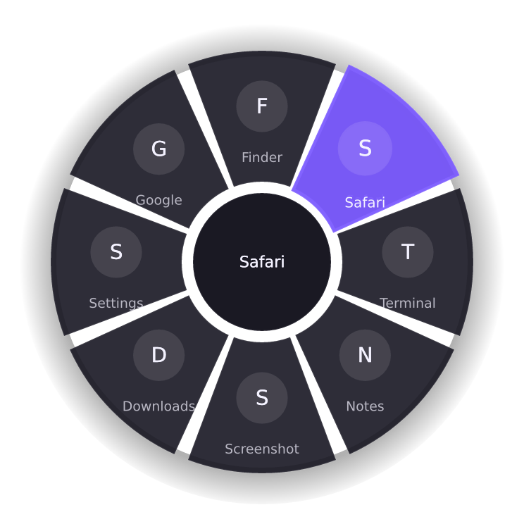

---
hide:
  - navigation
  - toc
---

{ .ring-hero width="300" }

# TheOrbit documentation

A radial quick menu around your cursor. **Hold right-click. Pick. Release.**

[Install TheOrbit](getting-started/install.md){ .md-button .md-button--primary }
[Quickstart](getting-started/quickstart.md){ .md-button }

TheOrbit opens a ring of apps and actions around your pointer when you hold the right mouse button. Move onto an item and release to run it. A normal short right-click still opens the usual context menu.

It is free, open source, and runs on macOS, Windows and Linux (X11).

## Find what you need

- **Get started**

    Install TheOrbit and open your first ring in five minutes.

    [Install](getting-started/install.md) · [Quickstart](getting-started/quickstart.md)

- **Use it every day**

    Learn the gestures, then fill the ring with your own items.

    [Gestures](usage/gestures.md) · [Menu items](usage/items.md) · [Settings and tray](usage/settings.md)

- **Set up your system**

    Permissions, tray icons and platform quirks.

    [macOS](platforms/macos.md) · [Windows](platforms/windows.md) · [Linux](platforms/linux.md)

- **Look something up**

    Every setting, and how the parts fit together.

    [Configuration](reference/configuration.md) · [Architecture](reference/architecture.md)

- **Fix a problem**

    Answers to the most common questions.

    [FAQ and troubleshooting](faq.md)

- **Help build it**

    Set up the project, run the checks, and ship a release.

    [Contributing](project/contributing.md) · [Changelog and roadmap](project/changelog.md)

## At a glance

| Gesture | Result |
| --- | --- |
| Right-click, released quickly | Normal context menu |
| Hold right-click (350 ms by default) | The ring opens, centred on the cursor |
| Move onto an item, then release | Runs that item |
| Release in the centre | Cancels |
| Right-drag before the hold delay | Passed through untouched |

Everything is stored in one JSON file that reloads when you save it. See the [configuration reference](reference/configuration.md).
