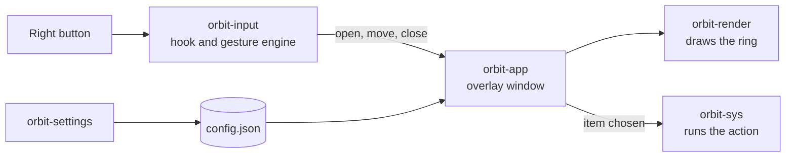
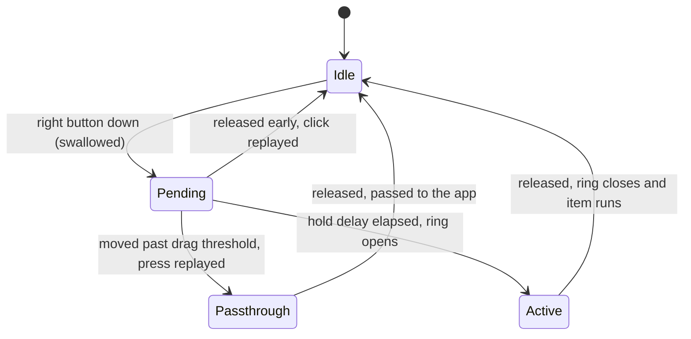

# Architecture

TheOrbit is a small Rust workspace. The parts that are the same on every system are kept apart from the parts that talk to the operating system, so new platforms can reuse the shared code.

## Crates

| Crate | What it does |
| --- | --- |
| `orbit-core` | The config model and the ring geometry. It has no platform code, so future mobile apps can share it. |
| `orbit-input` | The global right-button hook and the gesture state machine. |
| `orbit-render` | A CPU renderer and the animations for the ring, built on `tiny-skia`. It also draws the logo. |
| `orbit-sys` | Runs item actions, loads native app icons, plays the select sound, and knows where files live. |
| `orbit-app` | `theorbit`. The resident tray app, with a native overlay window for each system. |
| `orbit-settings` | `theorbit-settings`. The settings window, built with `egui` and started on demand. |

## How the pieces fit

1. **Hook.** A native hook sees the right mouse button before other apps do.
2. **Engine.** A small state machine decides whether this is a click, a drag, or a hold.
3. **Overlay.** On a hold, a transparent window opens at the pointer and draws the ring.
4. **Action.** On release over a segment, `orbit-sys` runs that item.

The resident app only does work while the right button is held. The rest of the time it waits.

## The gesture engine

The engine lives in `orbit-input` and has no platform code. Each operating system supplies a hook and a way to replay events.

The engine swallows the press so the app underneath does not react to it. If you let go early, it replays a full click. If you drag early, it replays only the press and steps aside.

A separate timer opens the ring after the hold delay. A counter makes sure a timer from an earlier press can never open the ring for a later one.

## Mouse hooks

| System | Hook |
| --- | --- |
| macOS | `CGEventTap`, which needs the Accessibility permission |
| Windows | `WH_MOUSE_LL`, a low-level mouse hook |
| Linux | An X11 passive grab, with XTEST to replay events |

## Ring geometry

The geometry in `orbit-core` is plain math with tests.

- Angles are measured clockwise from 12 o'clock, with the screen's y axis pointing down.
- Segment 0 is centred at the top. Segment 1 follows clockwise.
- Inside the cancel zone, no segment is selected.
- Outside the ring, the direction still picks a segment.

## Rendering

The ring is drawn on the CPU with `tiny-skia`, so there is no web view. The static ring is cached, so moving the highlight between items is cheap. App icons are decoded once, shrunk to at most 96 px, and cached per item.

## Settings and the running app

The settings window and the resident app do not share memory. They talk through two files in the config folder. The settings window writes `config.json`, and the app, which watches that folder, reloads it. The app writes `status.json`, so the settings window can show whether TheOrbit is running, needs a permission, or failed to start.

## Single copy

At startup the app takes a lock file. A second launch finds the lock held, opens the settings window, and exits.

## Release build

Releases are built with link-time optimization, a single codegen unit, size optimization (`opt-level = "s"`), and stripped symbols. The workspace is licensed under Apache 2.0.
